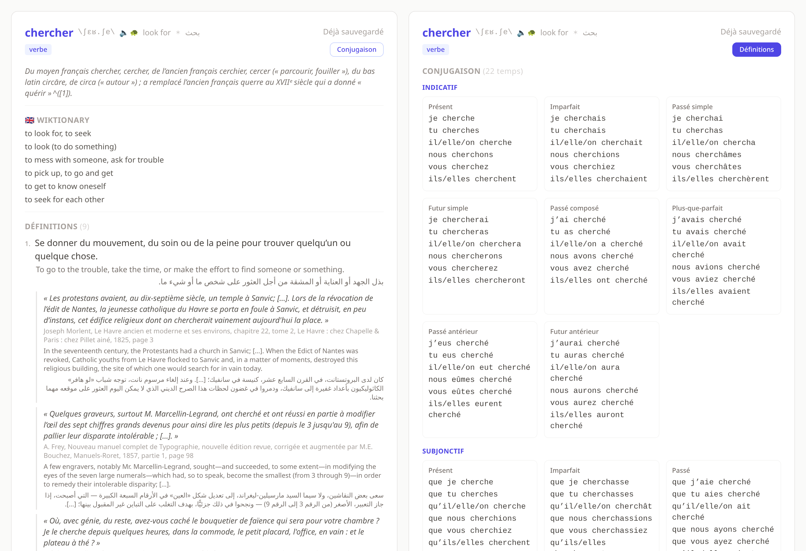

<div align="center">


# ouioui

**Look up a French word, keep it, review it.**

Every sense arrives in French, English and Arabic at once, with sourced example
sentences, pronunciation and the full conjugation. Words you keep come back as
spaced-repetition flashcards.




</div>

Runs in [homelab](https://github.com/lemmebee/homelab) at `http://ouioui.localhost`.

## Where the words come from

Nothing is scraped. [kaikki.org](https://kaikki.org) publishes Wiktionary already
parsed into JSON, so a lookup reads structured data instead of guessing at HTML.
Three sources are merged on the way in:

| Source                   | What it contributes                                                                                   |
|--------------------------|-------------------------------------------------------------------------------------------------------|
| kaikki fr-Wiktionary     | senses, cited examples, IPA, gender, sense-linked synonyms, derived forms, proverbs, etymology, conjugation, English and Arabic word translations |
| kaikki en-Wiktionary     | English glosses, written by people rather than translated                                              |
| DeepL                    | completes every sense to all three languages and fills whatever the first two leave open               |

The French corpus covers about 2 million word forms, comfortably more than a
commercial dictionary. Larousse, which this used to scrape, lists around 135,000
entries and defined `dépaysement` as *"état de celui qui est dépaysé"*.

English input works without a second dictionary: fr-Wiktionary glosses its
English entries in French, so `freedom` resolves to *Liberté*.

## One lookup

`chercher` returns nine senses. Each carries its French definition, an English
and an Arabic rendering aligned to it, register and topic tags, the synonyms
Wiktionary attached to that particular sense, and quoted examples with their
source. The first example of each sense is translated up front; the rest have a
`Traduire` button that translates on demand and stores the result, so the same
sentence is never paid for twice.

Saved words get their own page. The vocabulary list is an index: headword,
pronunciation, translations, one line of preview, next review date.

## Conjugation

Verbs carry 22 tenses across indicative, subjunctive, conditional and imperative,
plus participles and gerunds, with the pronouns attached. It is a mode, not a
section: the toggle beside the part of speech swaps the card between its
definitions and its table, because stacking a 96-form table under a 39-sense
entry makes both unreadable.

## Review

`sm2.py` is SM-2. Ratings run 0 to 5, easiness is floored at 1.3, and the
interval that comes back sets the next date. Words and expressions share one
queue; whichever is due longest comes first.

Expressions are the other half. Wiktionary has no entry for `un répartiteur de
charge` or `être d'astreinte`, so those are stored as French/English pairs and
reviewed alongside the words.

## Design notes

**A word is fetched once, ever.** A first lookup costs four HTTP requests, or six
when a word has three plausible cases, plus two batched DeepL calls. The merged
record lands in `dict_cache` and every later lookup is a local read: 0.39s cold,
0.005s warm.

**Records carry a version.** A cache hit never re-fetches, so anything added to
the record afterwards would stay invisible on every word already looked up. Both
the cache and the saved rows compare `RECORD_VERSION` and re-fetch when they are
behind. Bumping the constant is the whole migration. The same check catches a
word saved while DeepL was unreachable, which would otherwise sit untranslated
forever.

**Translations complete the senses, they do not replace them.** en-Wiktionary's
English glosses are better prose than any machine translation, but they do not
line up with the French senses: `maison` has 16 senses and 4 English glosses. So
they are kept as their own block, and DeepL supplies the per-sense English that
actually corresponds, plus the Arabic that Wiktionary rarely carries.

**Case is part of the address.** kaikki shards entries by their exact spelling, so
`Maison` and `maison` are different files: the surname and the 16-sense common
noun. Every plausible case is fetched in parallel and the richest answer wins,
because a word typed at the start of a sentence should not resolve to a surname.

**Homonymous verbs each ship a full conjugation.** `écarter` is two verbs with
different etymologies, and merging their tables listed every tense twice. Forms
carry their pronoun, so identical strings within a tense are redundant and get
dropped.

**No browser dialogs.** Deleting asks in a styled modal, not `confirm()`, which
would otherwise announce the hostname to the user. htmx's `hx-confirm` is
intercepted through the `htmx:confirm` event; Escape and a backdrop click cancel.
Deletions swap in empty HTML and would say nothing, so the endpoints return an
`HX-Trigger` header that pops a toast.

**The speaker and the slow button are separate controls.** The speaker is pinned
to normal speed and the settings menu configures only the turtle, so the two are
never the same rate. Playback picks a local French voice: remote network voices
commonly ignore `rate` outright, which makes a speed setting look broken.

**Handlers are synchronous on purpose.** They touch SQLite, fetch over HTTP with a
20 second timeout and call DeepL. Declared `async def`, one slow lookup would
stall every other request in the process; as plain `def`, Starlette runs them in
its threadpool. A page renders in 3ms while four cold lookups are in flight.

**The app works without DeepL.** With no key the French senses, IPA, examples and
conjugation all still arrive, along with whatever translations Wiktionary carries
itself, and the translate buttons hide rather than fail.

## State

One SQLite file, at `DB_PATH` (`/data/ouioui.db` in the container, the
`ouioui-data` volume):

```text
words              # headword, senses as JSON, conjugation, IPA, etymology, version
reviews            # SM-2 state, one row per word
expressions        # French/English pairs with no dictionary entry
expression_reviews # SM-2 state, one row per expression
dict_cache         # merged lookup records, keyed by word
```

The image is disposable. `make rollout app=ouioui` rebuilds it and keeps all of
the above; `make clean` deletes the volume and there is no other copy.

## Configuration

| Variable         | Default      | Meaning                                                        |
|------------------|--------------|----------------------------------------------------------------|
| `DEEPL_API_KEY`  | unset        | Enables the English and Arabic completion layer                 |
| `DB_PATH`        | `ouioui.db`  | Where the database lives (`/data/ouioui.db` in the container)   |
| `PORT`           | `8080`       | Port uvicorn binds in the container                             |

Put them in `.env` at the project root; it is loaded on start and gitignored.

## Local development

```sh
python -m venv .venv && .venv/bin/pip install -r requirements.txt
.venv/bin/uvicorn app:app --reload
```

Then `http://localhost:8000`. The schema is created on first boot and migrations
run at startup, so there is no separate migrate step.

## Layout

```text
ouioui/
├── app.py           # routes; every handler is sync, Starlette threadpools them
├── dictionary.py    # kaikki fetch, three-way merge, conjugation, DeepL completion
├── db.py            # schema, column migrations, lookup cache, staleness rules
├── sm2.py           # spaced repetition
├── templates/
│   ├── base.html    # shell, speech, toasts, confirm modal, settings menu
│   └── partials/
│       └── _macros.html   # sense, example, conjugation and speaker rendering
└── static/          # one stylesheet; Tailwind and htmx come from a CDN
```

## Credits

Dictionary content is [Wiktionary](https://fr.wiktionary.org), licensed
[CC BY-SA 4.0](https://creativecommons.org/licenses/by-sa/4.0/), reached through
[kaikki.org](https://kaikki.org) by Tatu Ylonen. Translations by DeepL.
