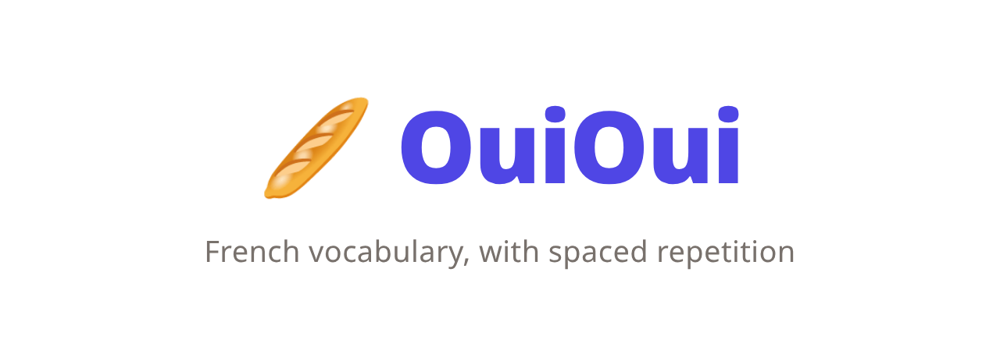
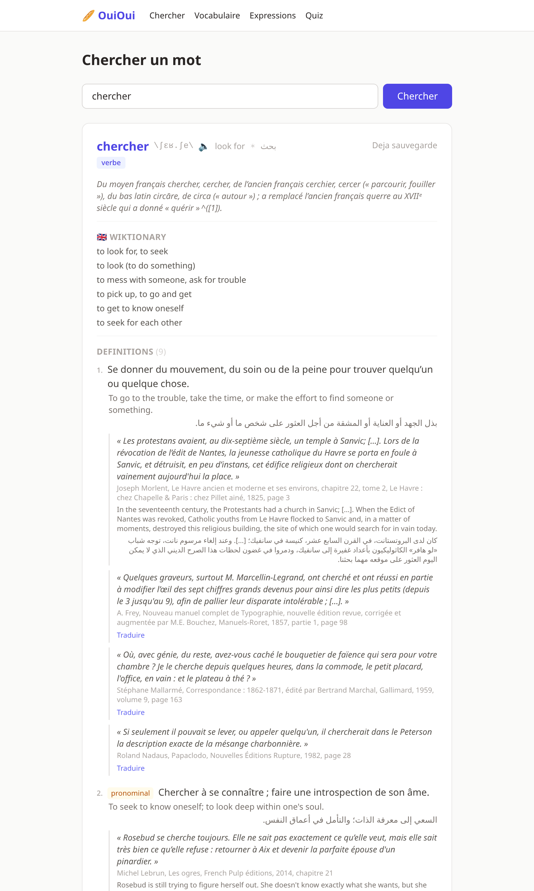
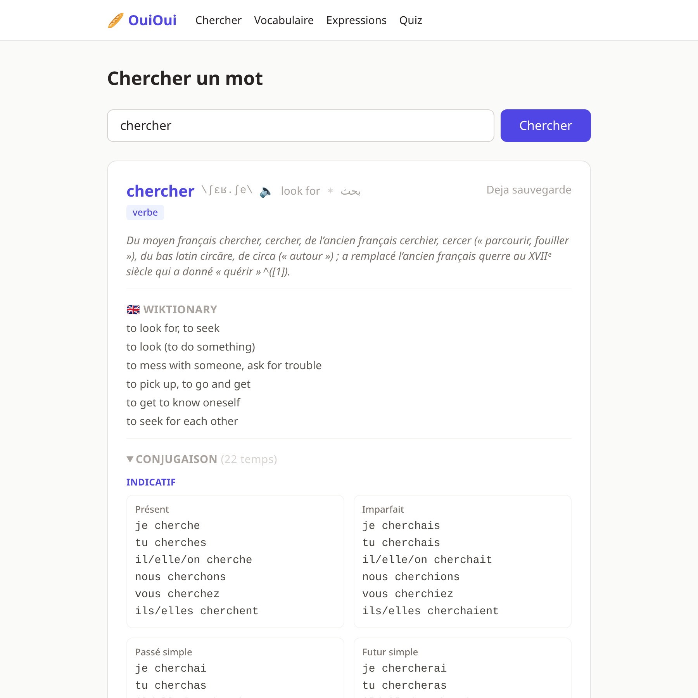
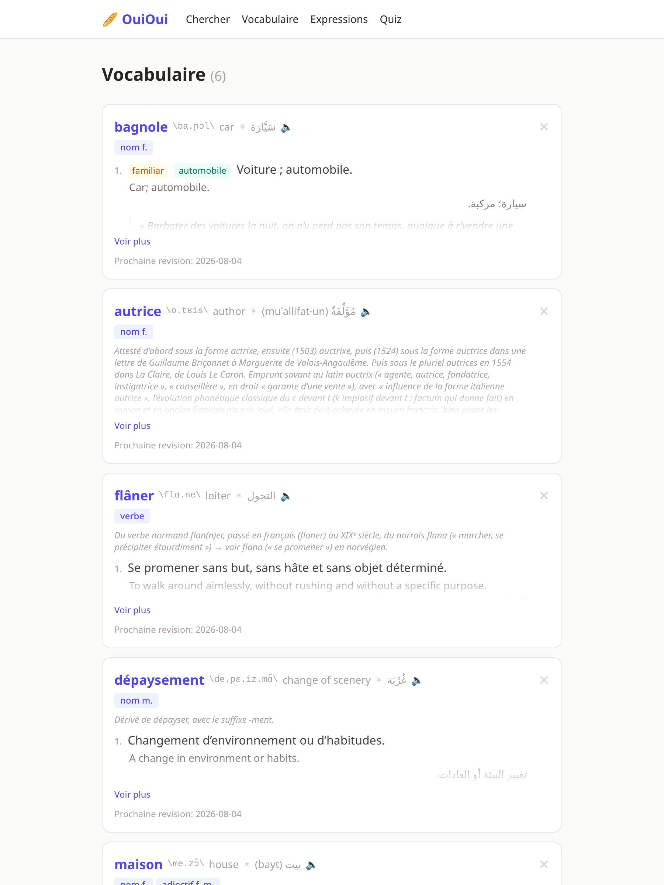
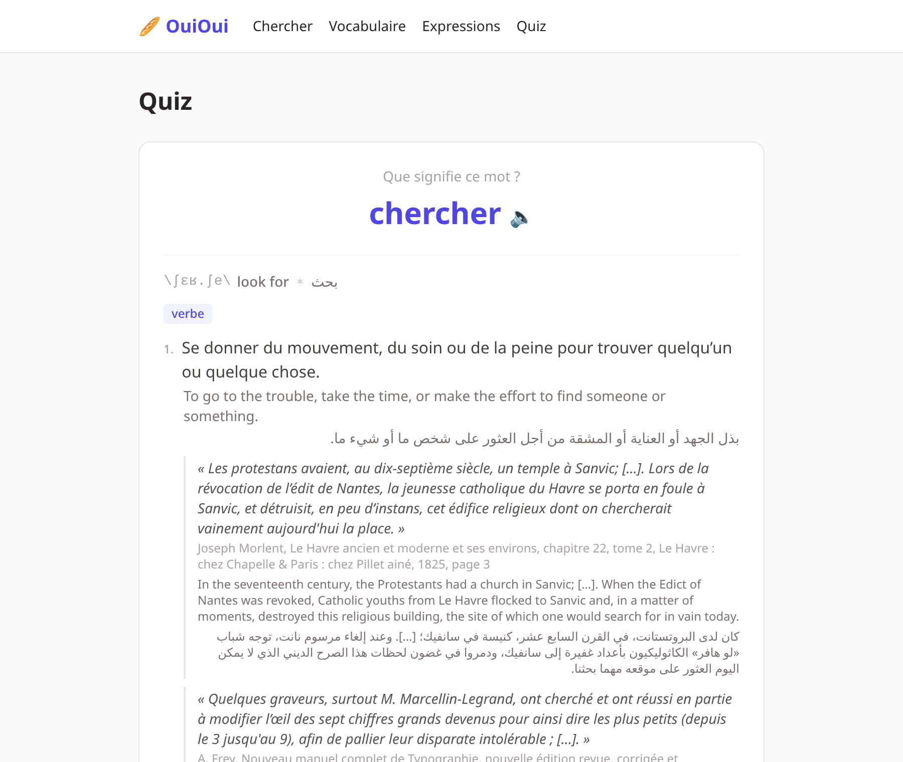

<div align="center">



**Look up French words, save them, and review them with spaced repetition.**

Every definition comes with its English and Arabic translation, real cited examples,
pronunciation, and full verb conjugation.

<sub>
  Built with FastAPI, HTMX and Tailwind, backed by Wiktionary and DeepL
</sub>

</div>

---

## Screenshots

<div align="center">



<sub><b>Search.</b> Each sense in French, English and Arabic, with sourced literary examples.</sub>

<br><br>



<sub><b>Conjugation.</b> 22 tenses per verb, grouped by mood, collapsed until you want them.</sub>

<br><br>



<sub><b>Vocabulary.</b> Your saved words, with pronunciation and review dates.</sub>

<br><br>



<sub><b>Quiz.</b> SM-2 flashcards over both words and expressions.</sub>

</div>

---

## Features

- **Rich lookups.** Definitions, IPA, gender, etymology, sense-linked synonyms,
  derived forms, proverbs and inflected forms.
- **Trilingual.** Every sense carries French, English and Arabic, kept aligned so a
  definition and its translations always match.
- **Cited examples.** Real sentences with their source, from Balzac to contemporary
  press. The first example of each sense is translated up front; the rest translate
  on demand and are then stored.
- **Verb conjugation.** 22 tenses across indicative, subjunctive, conditional and
  imperative, plus participles and gerunds.
- **Spaced repetition.** SM-2 flashcards over saved words and expressions.
- **English input.** Type `freedom` and get *Liberté*.
- **Text to speech.** Hear any word pronounced in French.

## Where the data comes from

Three layers, merged on each lookup:

| Layer | Provides |
|---|---|
| [kaikki.org](https://kaikki.org) fr-Wiktionary | senses, cited examples, IPA, gender, sense-linked synonyms, derived forms, proverbs, etymology, conjugation, English and Arabic word translations |
| kaikki.org en-Wiktionary | human-written English glosses |
| [DeepL](https://www.deepl.com/pro-api) | completes every sense to French, English and Arabic, and fills whatever the first two layers leave open |

kaikki serves Wiktionary pre-parsed as JSON, so there is no HTML scraping and no
brittle selectors to maintain. The French corpus covers roughly 2M word forms,
comfortably more than a commercial dictionary.

English input works because fr-Wiktionary glosses English entries in French, so an
English headword resolves to its French meaning without a separate bilingual source.

## Quick start

```bash
python -m venv .venv
.venv/bin/pip install -r requirements.txt
.venv/bin/uvicorn app:app --reload
```

Open `http://localhost:8000`.

### Configuration

| Variable | Required | Description |
|---|---|---|
| `DEEPL_API_KEY` | No | Enables the English and Arabic completion layer. Without it, French senses and whatever translations Wiktionary already carries still work, and the translate buttons hide themselves. |
| `DB_PATH` | No | SQLite file location. Defaults to `ouioui.db` beside the app. |

Put them in a `.env` file at the project root; it is loaded automatically and is
gitignored.

## Deployment

```bash
docker build -t ouioui .
docker run -p 8080:8080 -e DEEPL_API_KEY=... -v ouioui-data:/data -e DB_PATH=/data/ouioui.db ouioui
```

A Render blueprint is included in `render.yaml`.

## How it works

**Caching.** A first lookup costs four HTTP fetches (six when a word has three case
variants, since kaikki paths are case-sensitive and both sources are probed in
parallel) plus two batched DeepL calls. The merged record is stored in a
`dict_cache` table, so every later lookup of that word is a local read.

**Record versioning.** Records carry a `RECORD_VERSION`. Both the cache and the
saved-words table re-fetch anything produced by an older version, or anything whose
translations are missing while DeepL is configured. Without this a cache hit would
never re-fetch, so a newly added field would stay invisible on every word already
looked up, and a word saved during a DeepL outage would stay untranslated forever.

**Spaced repetition.** `sm2.py` implements SM-2. Ratings run from 0 to 5, easiness
is floored at 1.3, and the next review date is derived from the resulting interval.

## Project layout

```
app.py               FastAPI routes
dictionary.py        Wiktionary fetch, merge, and DeepL completion
db.py                SQLite schema, migrations, lookup cache
sm2.py               Spaced repetition algorithm
templates/           Jinja2 pages and HTMX partials
  partials/_macros.html   shared sense, example and conjugation rendering
static/              stylesheet
```

## Credits

Dictionary content comes from [Wiktionary](https://fr.wiktionary.org), licensed
[CC BY-SA 4.0](https://creativecommons.org/licenses/by-sa/4.0/), via
[kaikki.org](https://kaikki.org) by Tatu Ylonen. Translations are provided by DeepL.
